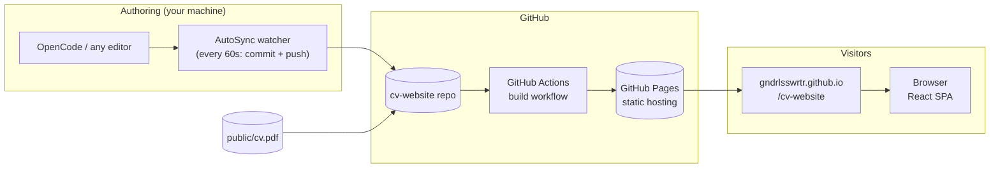
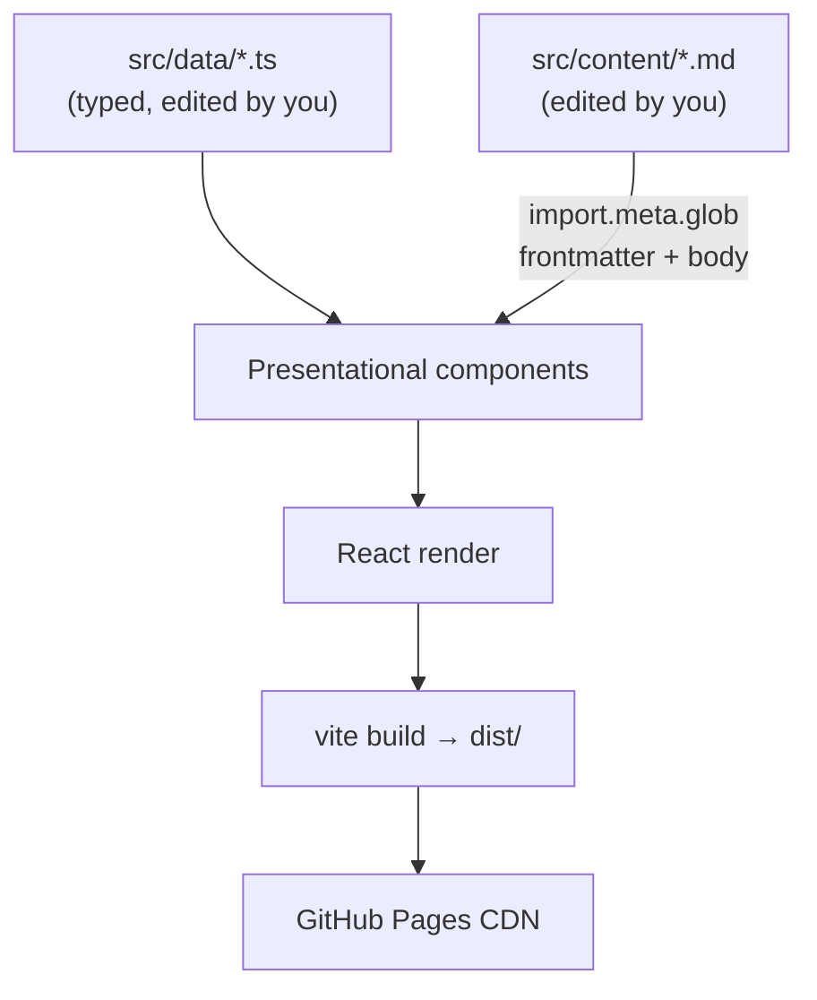
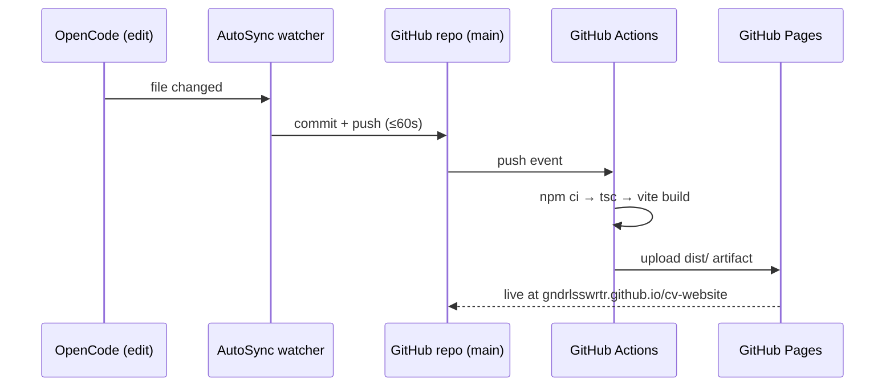

# CV Website — System Architecture

> Status: proposed · Stack: React + Vite (TypeScript) · Hosting: GitHub Pages
> Repo: `gndrlsswrtr/cv-website` · Every change here auto-pushes to GitHub within ~60s.

---

## 1. Overview

A fast, static personal CV website with:

- **Core CV sections** — profile, experience, education, skills, contact
- **Downloadable PDF** — a ready-made PDF of the CV served from `/public`
- **Projects / blog pages** — data-driven project cards with detail pages, plus markdown blog posts

There is **no backend**. Content lives in the repo as typed data files and markdown; the site is
compiled to static files and served by GitHub Pages's CDN.



---

## 2. Goals & constraints

| Goal | How |
|---|---|
| Instant load | Static bundle, no server render, CDN-served; target Lighthouse ≥ 95 |
| Edit without touching code | CV content isolated in `src/data/*.ts`, blog in `src/content/*.md` |
| Zero maintenance | GitHub Pages + Actions; no servers, no database, no cost |
| Mobile-friendly | Responsive layout, mobile-first CSS |
| Deep links work on Pages | Hash-based routing (see §6, decision log) |

---

## 3. Tech stack

| Layer | Choice | Reason |
|---|---|---|
| UI | React 18 + TypeScript | Component model, type-safe content |
| Build | Vite 5 | Instant dev server, fast static builds |
| Routing | react-router-dom (**HashRouter**) | Client-side pages; hash URLs avoid GitHub Pages 404s on refresh |
| Styling | Plain CSS with CSS custom properties (design tokens) | No runtime cost; easy theming |
| Blog content | Markdown files loaded via `import.meta.glob` + `react-markdown` | Write posts in `.md`, no CMS |
| PDF | Static file in `public/cv.pdf` | Served as-is, no generation step in CI (v1) |
| Hosting | GitHub Pages via GitHub Actions | Free, integrated with this repo |
| CI | GitHub Actions (`deploy.yml`) | Build + deploy on every push to `main` |

---

## 4. Repository structure

```
cv-website/
├── .github/
│   └── workflows/
│       └── deploy.yml          # build + deploy to Pages on push to main
├── public/
│   ├── cv.pdf                  # downloadable PDF version of the CV
│   ├── favicon.svg
│   └── og-image.png            # social share preview image
├── src/
│   ├── main.tsx                # React entry point
│   ├── App.tsx                 # router + route definitions
│   ├── layout/
│   │   ├── Layout.tsx          # page shell: header + outlet + footer
│   │   ├── Header.tsx          # logo + nav links
│   │   └── Footer.tsx
│   ├── pages/
│   │   ├── HomePage.tsx        # the CV itself (all core sections)
│   │   ├── ProjectsPage.tsx    # grid of project cards
│   │   ├── ProjectPage.tsx     # single project detail  /#/projects/:slug
│   │   ├── BlogPage.tsx        # post list
│   │   └── PostPage.tsx        # single post             /#/blog/:slug
│   ├── components/
│   │   ├── Section.tsx         # titled CV section wrapper
│   │   ├── Timeline.tsx        # experience / education entries
│   │   ├── SkillBadge.tsx
│   │   ├── ProjectCard.tsx
│   │   ├── DownloadCVButton.tsx
│   │   └── Markdown.tsx        # shared markdown renderer
│   ├── data/                   # ✏️ everything you edit lives here
│   │   ├── profile.ts          # name, title, contact, social links
│   │   ├── experience.ts       # work history entries
│   │   ├── education.ts
│   │   ├── skills.ts
│   │   └── projects.ts         # project metadata (title, slug, stack, links)
│   ├── content/
│   │   └── blog/               # ✏️ markdown blog posts (one file per post)
│   │       └── hello-world.md
│   ├── types/
│   │   └── index.ts            # interfaces: Profile, Experience, Project…
│   └── styles/
│       ├── tokens.css          # colors, spacing, fonts (design tokens)
│       └── global.css
├── index.html
├── vite.config.ts              # base: '/cv-website/' for Pages subpath
├── tsconfig.json
├── package.json
├── ARCHITECTURE.md              # this file
└── .gitignore
```

---

## 5. Frontend architecture

### Component tree

```
App (HashRouter)
└── Layout
    ├── Header (nav: Home · Projects · Blog · Download PDF)
    ├── <route>
    │   ├── HomePage
    │   │   ├── Section "Profile"        → profile data
    │   │   ├── Section "Experience"     → Timeline(data.experience)
    │   │   ├── Section "Education"      → Timeline(data.education)
    │   │   ├── Section "Skills"         → SkillBadge[] (data.skills)
    │   │   └── Section "Contact"        → contact links + DownloadCVButton
    │   ├── ProjectsPage
    │   │   └── ProjectCard[]            → data/projects.ts
    │   ├── ProjectPage                  → find by :slug
    │   ├── BlogPage                     → glob(content/blog/*.md)
    │   └── PostPage                     → find by :slug
    └── Footer
```

### Routing

| URL | Page | Source of content |
|---|---|---|
| `/#/` | HomePage (the CV) | `src/data/*.ts` |
| `/#/projects` | ProjectsPage | `src/data/projects.ts` |
| `/#/projects/:slug` | ProjectPage | `src/data/projects.ts` + optional detail field |
| `/#/blog` | BlogPage | `src/content/blog/*.md` frontmatter |
| `/#/blog/:slug` | PostPage | matching `.md` file |

### Data flow



- **No fetching at runtime.** Data files are compiled into the bundle, so the site works
  offline-of-backend and renders instantly.
- Components are **pure functions of data** — swapping content never requires touching
  component code.
- Blog markdown is discovered at build time by Vite's `import.meta.glob(..., { eager: true })`,
  so a new post = drop a file in `src/content/blog/`, nothing else.

---

## 6. Decision log

| Decision | Why | Alternative rejected |
|---|---|---|
| Static SPA, no backend | A CV site needs no server; static = free, fast, unhackable surface | Node/Express server — cost & maintenance for zero benefit |
| **HashRouter** | GitHub Pages serves only static files; `/#/projects/x` survives refresh with no server config | BrowserRouter needs a `404.html` redirect hack |
| Data in `.ts` files | Type-checked by the editor; typos in `experience.ts` show as compile errors | JSON — no types; headless CMS — overkill |
| Blog as markdown | Posts are content, not code; readable in raw form on GitHub | DB-backed blog — needs a backend |
| PDF in `public/` | No build step; replace the file any time | Generating PDF in CI from HTML — fragile, deferred to v2 |
| CSS design tokens | One place to change theme; zero runtime CSS-in-JS cost | Tailwind/styled-components — extra toolchain weight for this size |

---

## 7. Build & deploy pipeline



**`deploy.yml` outline:**

```yaml
on: { push: { branches: [main] } }
jobs:
  deploy:
    runs-on: ubuntu-latest
    steps:
      - uses: actions/checkout@v4
      - uses: actions/setup-node@v4
        with: { node-version: 20, cache: npm }
      - run: npm ci
      - run: npm run build        # tsc && vite build
      - uses: actions/deploy-pages@v4   # one-time: Settings → Pages → Source: GitHub Actions
```

**Vite config note:** `base: '/cv-website/'` so asset URLs resolve under the Pages subpath.

---

## 8. Quality & performance targets

- **Lighthouse:** Performance / Best Practices / SEO ≥ 95
- **Bundle budget:** ≤ 150 KB gzipped initial (React + router ≈ 45 KB; rest is your code)
- Route-level code splitting via `React.lazy` if the blog grows
- Semantic HTML (`<main>`, `<article>`, headings) for accessibility + SEO
- Responsive breakpoints: 480 / 768 / 1024 px
- `npm run typecheck` and `npm run lint` run in CI before deploy

## 9. Security & privacy

- Static site → no server, no database, no user data, no attack surface beyond the CDN
- No analytics by default (add Plausible later if wanted — privacy-friendly, no cookies)
- Dependencies audited with `npm audit` in CI
- The git credential used for pushing is scoped to this machine only, never committed

## 10. Future extensions (v2+)

1. **PDF generation from content** — render `src/data` to PDF in CI so PDF and web never drift
2. **Dark/light theme toggle** — tokens already in place, add a switch + `localStorage`
3. **Contact form** — Formspree/Netlify Forms endpoint (still no backend of our own)
4. **i18n** — swap data files per locale
5. **Custom domain** — `CNAME` file in `public/`

---

## 11. Implementation phases

| Phase | Deliverable | Done when |
|---|---|---|
| 1. Scaffold | Vite + React + TS project, routing shell, CI workflow | `npm run dev` renders Layout; CI deploys empty site |
| 2. CV content | Data files + HomePage sections | All core sections render from data |
| 3. Projects & blog | ProjectCard/detail + markdown pipeline | One sample project & post live |
| 4. PDF & polish | `cv.pdf`, responsive pass, SEO meta, OG image | Lighthouse ≥ 95 on mobile |
| 5. Publish | Enable GitHub Pages (Actions source) | Site live at the Pages URL |
